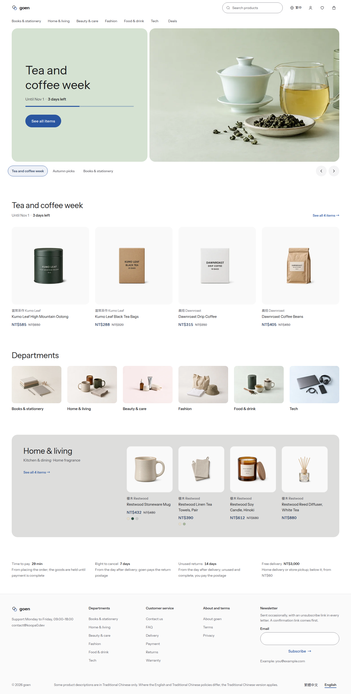
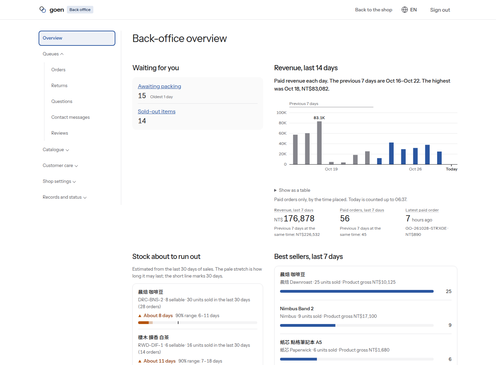

<h1> goen</h1>

English | [繁體中文](README.zh-TW.md)

[](https://github.com/Koopa0/goen/actions/workflows/verify.yml)
[](go.mod)
[](LICENSE)

A complete e-commerce shop built with Go — from browsing to checkout, after-sales and the back office that runs it.

**Live demo: [goen.koopa0.dev](https://goen.koopa0.dev)**





## Features

**Shopping**
- Departments and categories with filters, sorting and search
- Product variants, reviews, questions and side-by-side comparison
- Wishlist, and a store in Traditional Chinese and English

**Checkout**
- Guest or member checkout, home delivery or convenience-store pickup
- Card payments through Stripe; coupons and store credit
- E-invoices issued automatically through ECPay

**After the order**
- Order tracking, returns within the seven-day period, warranty registration
- Reward points that turn into store credit

**Back office**
- Orders, fulfilment, returns and refunds
- Products, stock, pricing, campaigns and the home page
- Customers, reviews and questions; staff sign-in with two-factor codes and an audit log

## Built with

Go · templ · htmx · PostgreSQL · Stripe · ECPay

How it holds together — database roles, the rules the database enforces and the checks behind them: [ARCHITECTURE.md](ARCHITECTURE.md)

## Try the demo

Sign in with the demo account shown on the sign-in page, and pay with Stripe's test card 4242 4242 4242 4242.

To give your own copy 90 days of past orders, run this once, with goen stopped, on a database built by `make db-seed` that has an admin account:

```sh
psql "$GOEN_DATABASE_URL" -X -v ON_ERROR_STOP=1 -v demo_database=<its name> -f seed/demo_history.sql
```

Stripe and ECPay never saw those orders, so refunding one, voiding its invoice or issuing an allowance from the back office fails at their sandbox, like any request they reject. Their invoice numbers use a made-up DM track, since goen accepts only numbers shaped like a real 統一發票 number, and each refunded return carries the allowance (折讓) staff would have filed for it, numbered the same way.

If you keep that database as a snapshot and restore it on a later day, its history no longer ends yesterday. After each restore, before goen starts, move it to today by naming the day the snapshot was taken. That day must be the database's own date, which the script reads from the seed's shipping rates: they take effect from midnight of the day the history ran, and every run moves them along. Any other day is refused, so a second run on the same restore, or on a snapshot taken on a later day than its date, changes nothing:

```sh
psql "$GOEN_DATABASE_URL" -X -v ON_ERROR_STOP=1 -v demo_database=<its name> -v anchor_day=<YYYY-MM-DD> -f seed/demo_shift.sql
```

The seed's two campaigns run from 20 and 3 days before the day it ran until 10 and 4 days after, so a local database seeded longer ago shows none running: rebuild it with `PGOPTIONS='-c goen.catalogue_seed=development' make db-reset`, or move it to today the same way, naming its date: the last day it was seeded, given a history or moved. Any other day is refused, and the refusal names the date. Whatever you wrote after that date moves too, so an order you placed since then ends up after today.

## Run it locally

You need Go 1.27, Docker and `psql`.

```sh
cp .env.example .env
echo "GOEN_TOTP_KEY=$(openssl rand -hex 32)" >> .env   # the staff second factor needs a key
make db-up
```

Choose one of the following paths on a fresh database. For the `psql` commands,
export `GOEN_DATABASE_URL` in your shell with the schema owner's connection
configured in `.env`. A value you export, or give on the `make` command line,
wins over `.env`.

### An empty shop

```sh
make migrate-up
psql "$GOEN_DATABASE_URL" -X -v ON_ERROR_STOP=1 -c "SELECT upsert_staff('you@example.com', '', 'admin')"
make run          # http://127.0.0.1:9700
```

Leave `GOEN_DEMO_ACCOUNT_EMAIL` and `GOEN_DEMO_ACCOUNT_PASSWORD` unset. The schema
starts without a catalogue, demo account or sample orders. Add the shop's
departments and products in the back office once you are in:

1. Open `/forgot`, enter the owner's email and submit. See **Reading local mail**
   for where the reset link arrives.
2. Open the link, choose a password, and sign in at `/signin`.
3. Open `/admin`. On first entry, press the enrol button, scan the QR code (or
   type the key) into an authenticator app, and enter its six digits together
   with the eight-digit setup code goen mails to the owner. That second mail
   arrives where the first did: in development its code is in the log's `body=`
   field, or in Mailpit.

### A local demo

```sh
make migrate-up
PGOPTIONS='-c goen.catalogue_seed=development' make db-seed
psql "$GOEN_DATABASE_URL" -X -v ON_ERROR_STOP=1 -c "SELECT upsert_staff('you@example.com', '', 'admin')"
```

Set `GOEN_DEMO_ACCOUNT_EMAIL` and `GOEN_DEMO_ACCOUNT_PASSWORD` in `.env` to offer
the shared customer sign-in when goen starts. Then start `make run` and set the
owner's password through `/forgot` and enrol the second factor on first entry to
`/admin`, as under **An empty shop**. Stop goen, load the history using the
command under **Try the demo**, then restart `make run`.

The catalogue seed requires the explicit development setting shown above; it also refuses a database that already contains products or orders. The setting declares seed intent and does not detect a production database automatically.
Use a fresh database for the demo catalogue; the history and date-shift scripts
operate on an existing demo as described above.

### Reading local mail

`make run` is development mode (`GOEN_INSECURE_COOKIES=1`), and only in that mode
two things hold. With no `GOEN_SMTP_ADDR`, goen prints each mail in full to its
log, including a `link=` field per URL, and marks it delivered: copy the reset
link from the terminal running `make run`. To read mail in a browser instead,
start [Mailpit](https://mailpit.axllent.org) and point goen at it, then restart:

```sh
docker run --rm -p 127.0.0.1:1025:1025 -p 127.0.0.1:8025:8025 axllent/mailpit
echo 'GOEN_SMTP_ADDR=127.0.0.1:1025' >> .env   # mail appears at http://127.0.0.1:8025
```

Outside development neither exists: a mail is never written to the log, because a
reset link is a credential, and goen sends only over STARTTLS with a verified
certificate, so a plain-SMTP sink is refused. Even in development, plain SMTP is
accepted only from a loopback address.

See [CONTRIBUTING.md](CONTRIBUTING.md) for tests and configuration.

## License

[Apache License 2.0](LICENSE). Security reports: [SECURITY.md](.github/SECURITY.md).
