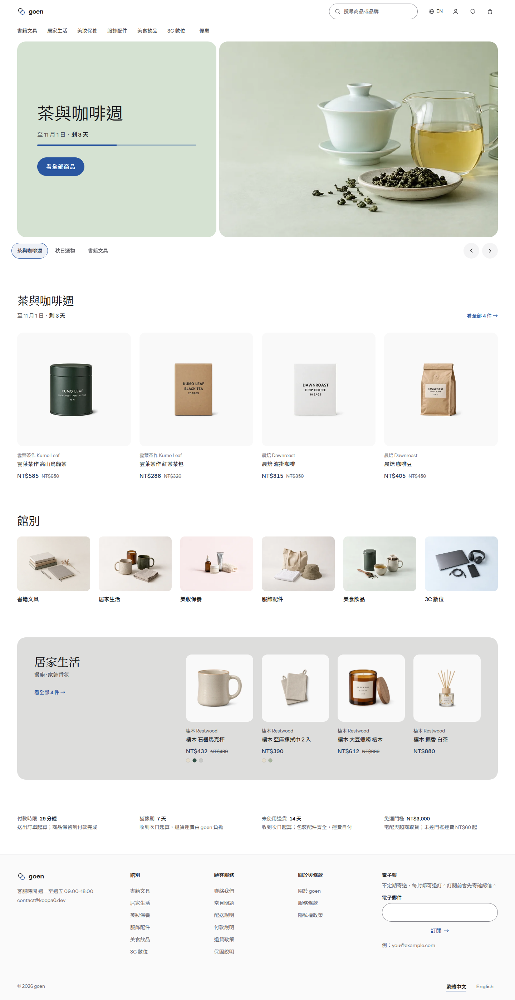
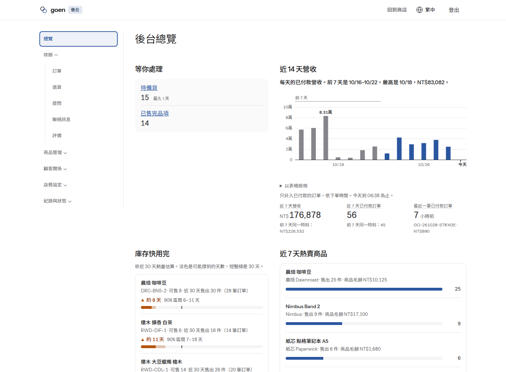

<h1> goen</h1>

[English](README.md) | 繁體中文

[](https://github.com/Koopa0/goen/actions/workflows/verify.yml)
[](go.mod)
[](LICENSE)

用 Go 打造的完整電商專案：從瀏覽、結帳、售後服務，到經營商店的後台。

**示範站：[goen.koopa0.dev](https://goen.koopa0.dev)**





## 功能

**購物**
- 館別與分類，支援篩選、排序與搜尋
- 商品規格、評論、問答與並排比較
- 收藏清單，介面提供繁體中文與英文

**結帳**
- 訪客或會員結帳，宅配或超商取貨
- Stripe 信用卡付款，折扣碼與購物金
- 綠界電子發票自動開立

**售後**
- 訂單查詢、七天猶豫期內退貨、保固登錄
- 會員點數可兌換購物金

**後台**
- 訂單、出貨、退貨與退款
- 商品、庫存、價格、活動與首頁管理
- 顧客、評論與問答；員工兩步驟驗證登入與操作紀錄

## 技術

Go · templ · htmx · PostgreSQL · Stripe · 綠界

系統怎麼分工、資料庫守住哪些規則、背後有哪些檢查：[ARCHITECTURE.zh-TW.md](ARCHITECTURE.zh-TW.md)

## 試用示範站

用登入頁上的示範帳號登入，付款時使用 Stripe 測試卡 4242 4242 4242 4242。

## 在本機執行

需要 Go 1.27、Docker 與 `psql`。

```sh
cp .env.example .env
make db-up
```

在全新的資料庫選擇下列一種啟動方式。執行 `psql` 指令前，請在 shell
匯出 `.env` 中設定的 `GOEN_DATABASE_URL`，使用 schema 擁有者的連線。

### 空白商店

```sh
make migrate-up
psql "$GOEN_DATABASE_URL" -X -v ON_ERROR_STOP=1 -c "SELECT upsert_staff('you@example.com', '', 'admin')"
make run          # http://127.0.0.1:9700
```

保持 `GOEN_DEMO_ACCOUNT_EMAIL` 與 `GOEN_DEMO_ACCOUNT_PASSWORD` 未設定。這時只有
schema，沒有商品目錄、示範帳號或範例訂單。到 `/forgot` 輸入店主的電子郵件，
設定密碼；第一次進入 `/admin` 時設定第二因素驗證。先在 `.env` 設定郵件與
`GOEN_TOTP_KEY`，再完成這些步驟。接著可在後台新增館別與商品。

### 本機示範商店

```sh
make migrate-up
PGOPTIONS='-c goen.catalogue_seed=development' make db-seed
psql "$GOEN_DATABASE_URL" -X -v ON_ERROR_STOP=1 -c "SELECT upsert_staff('you@example.com', '', 'admin')"
```

在 `.env` 設定 `GOEN_DEMO_ACCOUNT_EMAIL` 與 `GOEN_DEMO_ACCOUNT_PASSWORD`，
啟動 goen 時就會提供共用的顧客示範登入。設定郵件與 `GOEN_TOTP_KEY` 後，
執行 `make run`，透過 `/forgot` 設定店主密碼，第一次進入 `/admin` 時完成
第二因素驗證。停止 goen 後，可加入 90 天的示範歷史訂單，再重新啟動：

```sh
psql "$GOEN_DATABASE_URL" -X -v ON_ERROR_STOP=1 -v demo_database=<資料庫名稱> -f seed/demo_history.sql
make run          # http://127.0.0.1:9700
```

示範目錄需要以上指令明確指定開發用途，也會拒絕已經有商品或訂單的資料庫。這個設定表達載入示範資料的意圖，並不會自動判別正式資料庫。示範目錄請載入全新的資料庫。
示範歷史與日期平移的操作方式請見 [English README 的 Try the demo](README.md#try-the-demo)。

測試與設定請見 [CONTRIBUTING.md](CONTRIBUTING.md)。

## 授權

[Apache License 2.0](LICENSE)。安全性問題請依 [SECURITY.md](.github/SECURITY.md) 回報。
